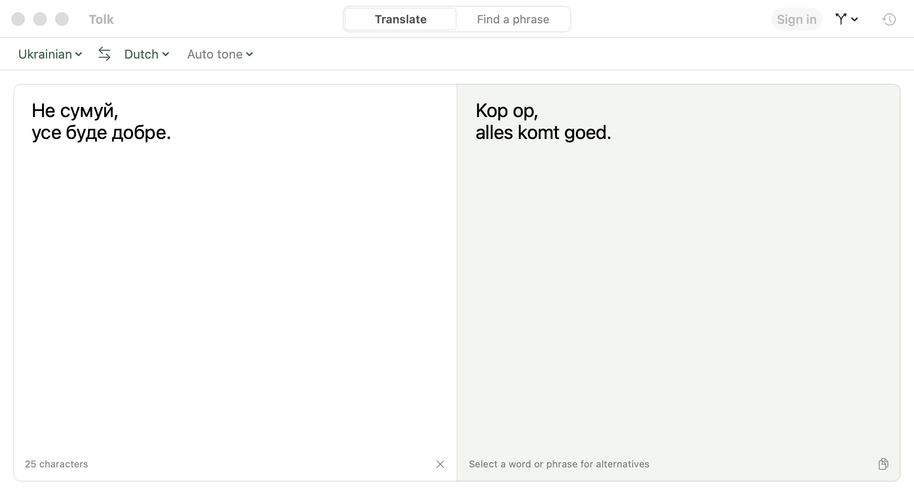
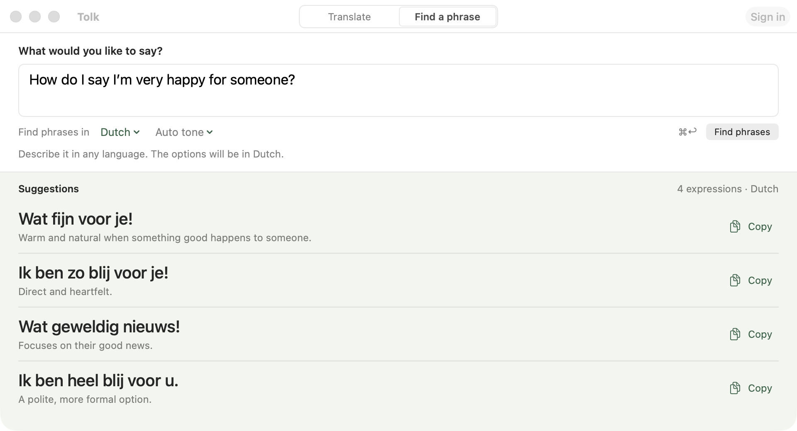

# Tolk

A small macOS app for translating text and finding the right phrase. It uses your ChatGPT subscription, so you don't need an OpenAI API key.



Type on the left; the translation appears on the right as you write. Choose a formal or informal tone, swap languages, or select a phrase to see alternatives. Pick a replacement and Tolk adjusts the rest of the sentence to fit.

When you know what you mean but can't find the words, switch to **Find a phrase**. Describe the situation in any language and get a few expressions in your target language, with notes on when to use them.



## What else it does

- Detects the source language. Ukrainian, English, and Dutch are enabled by default. Add other languages in Settings.
- Keeps a searchable local translation history. Star entries to find them later, delete them, or pause recording.
- Rebindable hotkeys cover translation, phrase finding, language-pair switching, suggestions, copying, and history. Optional global shortcuts translate selected text in other apps or replace it in place.
- Lets you choose separate models and reasoning levels for translation and phrase suggestions.
- Shows local token counts in Settings → AI → Usage, including input, output, and per-model totals when the service reports them.
- Supports light and dark appearances, a menu-bar icon, and hiding the Dock icon.

## Download

[Download Tolk.dmg](https://github.com/stasgavrylov/tolk/releases/latest/download/Tolk.dmg) for Apple silicon Macs running macOS 26 or later. Open the disk image and drag Tolk to Applications.

Release builds are ad-hoc signed, not notarized, so macOS may block the first launch. If it says the developer can't be verified, only proceed if you trust this download:

1. Open **System Settings → Privacy & Security** after the blocked launch.
2. Click **Open Anyway**.
3. Confirm **Open**.

## Build from source

You need **macOS 26 or later**, **Xcode 26 or later** with Swift 6.2+, and a ChatGPT account with Codex access, such as Plus or Pro. Building needs an internet connection to fetch the [KeyboardShortcuts](https://github.com/sindresorhus/KeyboardShortcuts) dependency.

1. Install Xcode and open it once to finish setup. Check that your terminal uses its toolchain:

   ```sh
   xcode-select -p
   swift --version
   ```

   If the developer path points to `/Library/Developer/CommandLineTools`, select Xcode instead (adjust the path if you installed it elsewhere):

   ```sh
   sudo xcode-select --switch /Applications/Xcode.app/Contents/Developer
   ```

2. Clone the repository:

   ```sh
   git clone https://github.com/stasgavrylov/tolk.git
   cd tolk
   ```

3. Build the app:

   ```sh
   scripts/build.sh
   ```

   This makes a release build at `build/Tolk.app`. The script uses the first available Apple Development signing identity, or ad-hoc signing if you don't have one. A paid Apple Developer account isn't required to build locally. A stable signing identity helps preserve Keychain and Accessibility permissions across rebuilds.

4. Open it:

   ```sh
   open build/Tolk.app
   ```

For a debug build, use `scripts/build.sh debug`. To install in `/Applications`, use `scripts/build.sh release --install`. **The install command quits a running Tolk and replaces any existing `/Applications/Tolk.app`.** Local builds aren't notarized.

To make a disk image after building, run `scripts/package-dmg.sh`. It writes `build/Tolk.dmg` with the app and an Applications shortcut.

## Sign in

Open Settings → AI → **Sign in with ChatGPT** and finish the browser login. If the browser can't return to Tolk, paste the final redirect URL into the field in Settings. Login uses local port `1455`, which can conflict with a Codex CLI login running at the same time.

Tolk uses the ChatGPT sign-in flow and service endpoint used by Codex. It isn't an official OpenAI app. Access depends on your plan, and changes to the service may break it. There is no API-key provider or offline translation mode.

## Shortcuts

| Action | Default |
|---|---|
| Translate / Find phrases | ⌘↩ |
| Swap languages and translate again | ⇧⌘S |
| Quick language pairs | ⌘1…⌘9 |
| Alternatives / idioms for selected text | ⌘E |
| Copy translation | ⇧⌘C |
| History | ⌘Y |

Selecting a word or short phrase in the translation also opens alternatives. In Find a phrase, ⌘↩ stops a running search; translation-only commands are disabled. History takes you back to Translate.

Rebind shortcuts in Settings → Shortcuts. Global shortcuts and the optional double-copy trigger are off by default. Selection-reading actions need Accessibility permission; normal translation in the app doesn't.

## Your data

Text you submit goes to OpenAI for translation or phrase suggestions. Tolk saves sign-in credentials in macOS Keychain and translation history locally on your Mac. You can pause or clear history in the app.

Usage stats cover Tolk requests on this Mac across signed-in accounts. Recording starts with this version; it doesn't recover earlier usage. These counts aren't account-wide billing, remaining quota, or dollar estimates.

The usage store keeps daily model/count totals, not text or credentials. Some requests, including stopped ones, may not report tokens; the UI labels missing and partial reports. Clearing translation history doesn't reset usage.

## Development

Run the core and native-window tests with:

```sh
swift test
```

The native tests use an offline provider, isolated settings, and in-memory stores. They don't need a ChatGPT login, register global hotkeys, or make their windows key.

[GitHub Actions](https://github.com/stasgavrylov/tolk/actions/workflows/build.yml) runs the non-UI tests and checks the mounted DMG. CI skips native-window tests. CI downloads expire after seven days; published releases don't.

To publish a release, push a `v` tag matching `CFBundleShortVersionString` in `Resources/Info.plist`, such as `v1.0` for version `1.0`. The release job resumes interrupted drafts but refuses to overwrite an existing public release. Use a new version tag for a new public build.

To capture test-window screenshots, run:

```sh
TOLK_UI_EVIDENCE_DIR=/tmp/tolk-ui swift test --filter NativeInterfaceTests
```

Screenshot capture needs existing Screen Recording permission and fails without prompting if it isn't available. These checks don't establish VoiceOver or Full Keyboard Access support.

The app lives in `Sources/Tolk`; shared translation, authentication, history, and usage code lives in `Sources/TolkCore`. See [the product spec](docs/SPEC.md) for behavior.

<details>
<summary>Local developer tools</summary>

`swift run TolkSmoke [model] [effort]` makes a live request using an existing Pi login at `~/.pi/agent/auth.json`. It reads that file without refreshing or writing credentials. This is optional and isn't part of the test suite.

Launching with `TOLK_DEV_PI_TOKEN=1` uses the same developer login with isolated settings and history. Setting `TOLK_DEV_SECRET` to at least 16 characters also enables the local distributed-notification command channel (`dev.stas.tolk.dev`). Commands must include that secret. The app writes `tolk-dev-state.json` in the per-user temporary directory with mode `0600`. `TOLK_DEV_BACKGROUND=1` keeps that developer launch from taking focus. None of these tools are active in a normal launch.

</details>
